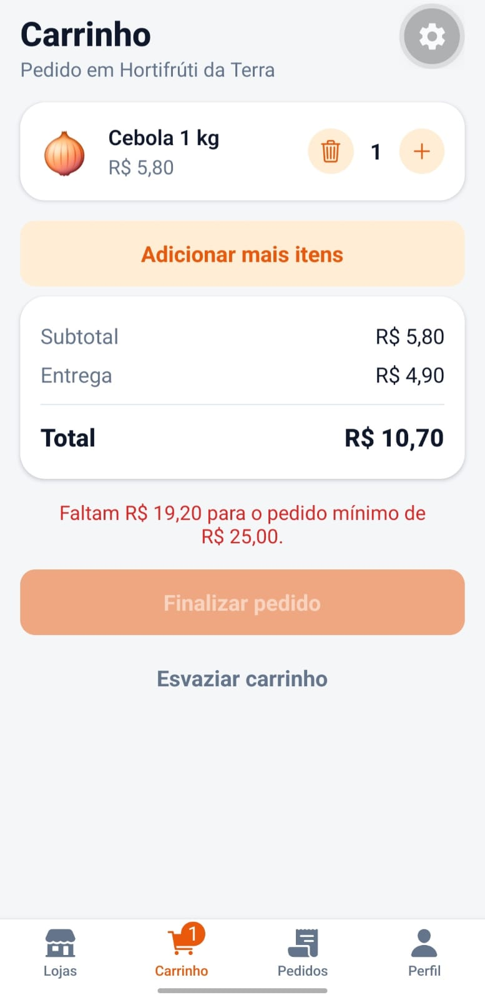
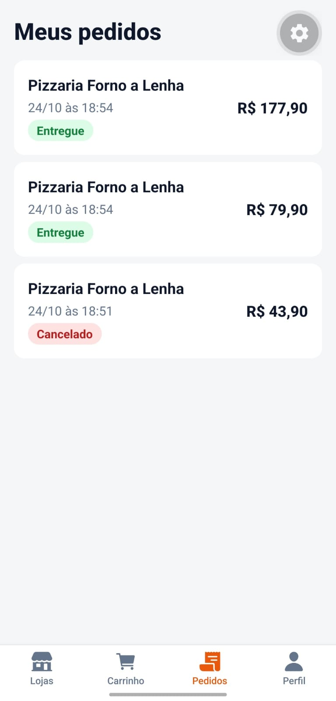

# MarketGo
Aplicativo mobile de compras com entrega: escolha uma loja, monte o carrinho, finalize o
pedido e acompanhe cada etapa até a entrega. Os pagamentos são simulados.
## Funcionalidades
- Cadastro, login e sessão persistente (Supabase Auth)
- Catálogo de lojas com busca, filtro por categoria e aviso de loja fechada
- Cardápio por seção, detalhe do produto e carrinho **salvo no aparelho**
- Regra de negócio: um carrinho por loja, com confirmação para trocar de loja
- Checkout com endereço, forma de pagamento e troco, validados com Zod
- Pedido criado no banco por uma função que **calcula o total com os preços do servidor**
- Acompanhamento com linha do tempo (atualiza sozinho), cancelamento e "Pedir novamente"
- Histórico de pedidos e dados isolados por usuário (Row Level Security)
## Capturas de tela

| Lojas | Carrinho | Acompanhamento | Pedidos |
| --- | --- | --- | --- |
|  |  |  |  |

## Tecnologias

React Native · Expo · Expo Router · TypeScript · Supabase (Auth, Postgres, RLS, funções SQL) ·
TanStack Query · React Hook Form · Zod · Jest · PGlite (testes do banco)
## Como executar
1. Instale as dependências: `npm install`
2. Crie um projeto no [Supabase](https://supabase.com) e execute, nesta ordem,
 `supabase/schema.sql` e `supabase/seed.sql` no SQL Editor.
3. Copie `.env.example` para `.env` e preencha a URL e a chave pública do projeto.
4. Inicie o app: `npx expo start` e abra no Expo Go.
## Segurança em uma linha
O app **não escreve** em `orders` nem em `order_items`: não há política de insert, update ou
delete. Toda escrita passa por funções (`create_order`, `advance_order`, `cancel_order`) que
validam os dados, calculam preços e controlam o status.
## Testes
| Comando | O que testa |
| ------------------ | ------------------------------------------------------ |
| `npm test` | Tudo: app (Jest) e banco (PGlite) |
| `npm run test:app` | Carrinho, catálogo, pedidos, checkout e dinheiro |
| `npm run test:db` | RLS, permissões, cálculo do pedido e status |
O teste do banco usa o PGlite (Postgres real dentro do Node), com o mesmo `schema.sql` e
`seed.sql` do Supabase, sem Docker.
## Arquitetura
```
app/ rotas (Expo Router)
src/
 components/ interface reutilizável
 context/ sessão e carrinho
 hooks/ consultas e mutações (TanStack Query)
 services/ acesso ao Supabase
 schemas/ validação (Zod)
 utils/ regras puras, cobertas por testes
supabase/
 schema.sql, seed.sql banco, RLS e funções
 tests/ testes do banco
```
## Autores

**Maria Clara Inácio**
- GitHub: https://github.com/mariaclarainacio/marketgo

**Matheus Augusto**
- GitHub: https://github.com/USUARIO-DO-MATHEUS